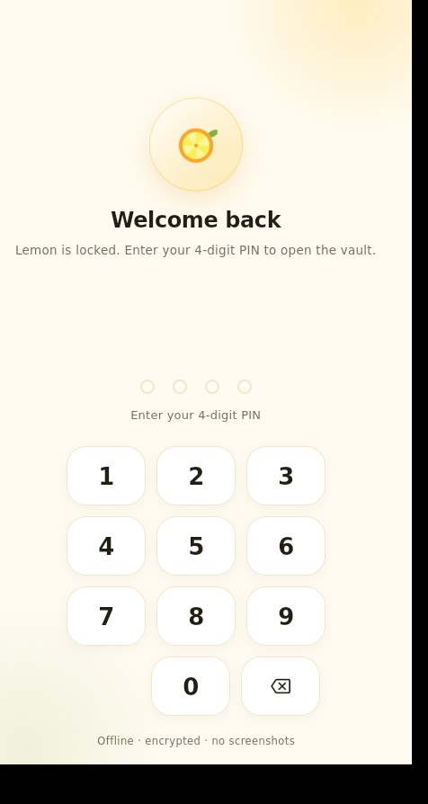
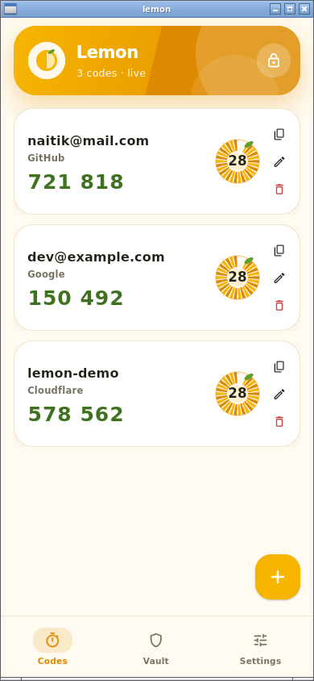
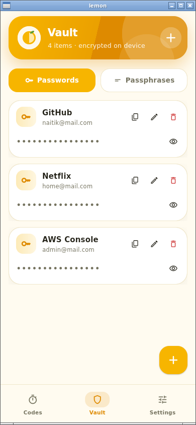
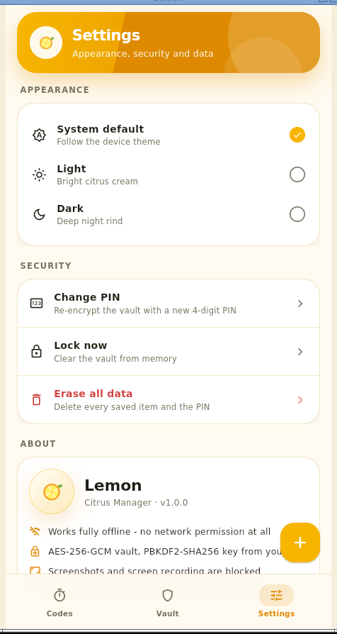

# Lemon 🍋 — Citrus Manager

A **cross-platform**, completely **offline** vault for passwords, passphrases and
TOTP codes — written **entirely in Flutter** (Dart) and shipping to **Android and
Windows** from one codebase (Linux builds from source).

<p align="center">
  
</p>

## What it does

| | |
| --- | --- |
| 🍋 **Live TOTP codes** | The countdown is a mini circular lemon cut into one slice per second. Each slice is eaten as its second passes, the lemon is gone at 30 s and a fresh one grows for the next window. Tap a card to copy, or use the copy / edit / delete buttons right beside the lemon. |
| 🔑 **Password manager** | Passwords and passphrases in two sections, tap-to-copy, reveal, edit and delete. Passphrases expand into numbered words. |
| 🎲 **Generators** | One tap for a 32-character password (every character class guaranteed) or a 1–64 word passphrase from a built-in dictionary. |
| 📷 **QR scanning** | Camera scans inside a framed grid — everything outside the square is a translucent theme-coloured mask. Only the square is decoded. |
| 🔒 **PIN lock + decoy** | Exactly 4 digits. The correct PIN opens the real vault; **any other PIN opens a decoy vault** with plausible fake data. |
| 🛡️ **Encrypted** | Vault is AES-256-GCM; the key comes from your PIN via PBKDF2-HMAC-SHA256 (120k rounds, random salt). |
| 🚫 **No screenshots** | `FLAG_SECURE` on Android, blocked capture APIs elsewhere. |
| ✈️ **Fully offline** | No `INTERNET` permission on Android, no telemetry, no cloud, no accounts. |

## Screenshots

<p align="center">
  
  
  
  
</p>

## Downloads

Every tagged release publishes two files (built by GitHub Actions on every tag):

- **Android** — `Lemon-<tag>.apk` (single universal APK, installs on any phone; sideload, no Play Store needed)
- **Windows** — `Lemon-<tag>-windows.zip` (unzip anywhere, run `lemon.exe`)

## Design

The UI is a warm citrus theme built with Material 3 — cream surfaces, gold
accents, leaf green highlights, and a matching dark mode. Everything is animated
with short, spring-based transitions: dots pop as you type a PIN, keys dip on
press, a wrong PIN shakes, cards stagger in, and screens cross-fade instead of
cutting.

## Build from source

```bash
flutter pub get
flutter test          # 30 unit + widget tests
flutter analyze

flutter build apk --release       # Android
flutter build windows --release   # Windows (run on Windows)
flutter create --platforms=linux .  # add the Linux runner first (not shipped)flutter build linux --release     # Linux (needs clang, cmake, ninja, libgtk-3-dev)
```

Requires Flutter 3.50 / Dart 3.9 or newer.

### Project layout

```
lib/
  main.dart                  app entry, theme mode, desktop window bounds
  src/
    theme.dart               palette + Material 3 theme (light & dark)
    models.dart              VaultEntry / TotpEntry (JSON round-trip)
    crypto_util.dart         PBKDF2 key derivation, AES-256-GCM, verifier
    vault_store.dart         encrypted store, atomic saves, real + decoy vaults
    totp.dart                RFC 6238 TOTP + otpauth:// parsing
    generator.dart           password / passphrase generation
    wordlist.dart            256-word dictionary
    screens/                 setup, unlock, home shell, codes, vault,
                             settings, entry + TOTP editors, scanner
    widgets/                 lemon timer, PIN entry, header, cards, logo
    platform/                secure-screen channel
logo.png                     the only bundled asset (app logo)
android/                     Java-only host (FLAG_SECURE + launcher icon)
windows/                     Windows runner
linux/                       not tracked - recreate with `flutter create --platforms=linux .`
test/                        crypto, TOTP vectors, persistence, widget tests
```

## Security notes

- The vault file is never partially written: saves go to a temp file, are
  flushed, renamed into place, and mirrored to `<vault>.bak`. A corrupt main
  file falls back to the backup instead of showing an empty vault.
- The real vault and the decoy vault are separate encrypted files with separate
  salts. Erasing data deletes both plus all PIN material.
- Changing the PIN re-encrypts the vault; inside the decoy vault it only
  pretends to (so it cannot break the real vault).
- The release APK is signed with Flutter's debug keystore so it installs
  anywhere. Use your own keystore for store distribution.
